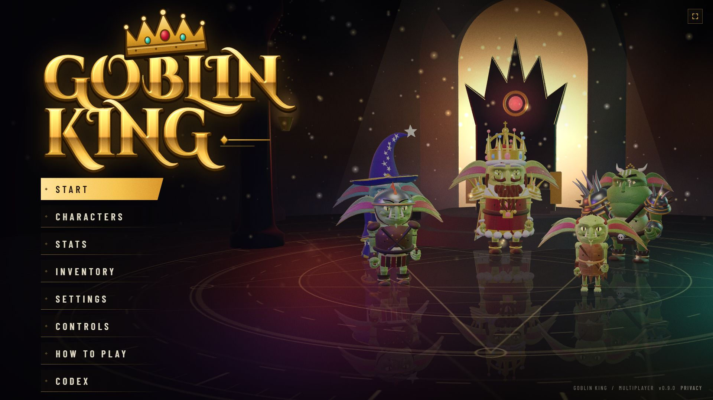
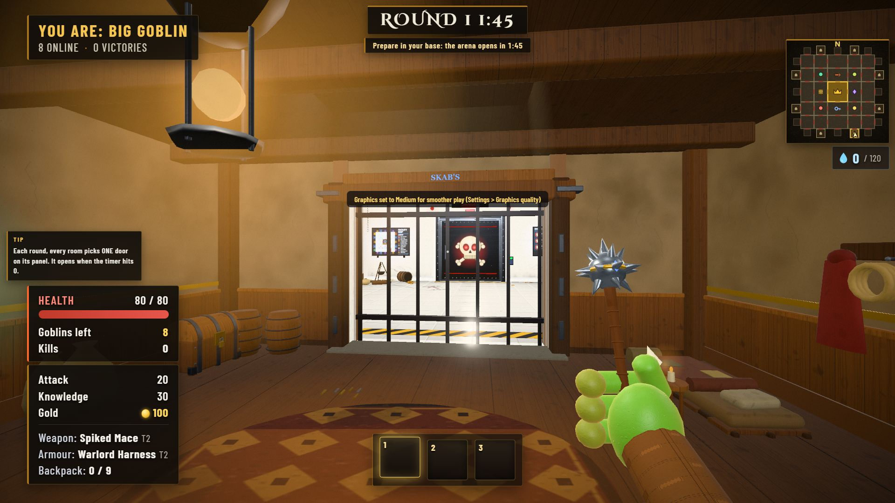

# Goblin King

A multiplayer goblin heist that runs in the browser. Eight goblins share a 5x5 grid of rooms around THE VAULT. Round 1 you prepare in your own base: craft, recycle, brew. Then the arena opens. Each round every room votes on one door, and the picked doors open when the timer hits 0:00. Loot chests, gamble on mystery rooms, trade with merchants, crack the vault, and be the last goblin standing. A win keeps your goblin and its stash for the next run.





## Play

Open the game in a desktop browser (Chrome, Edge or Firefox from 2023 on, or Safari 16.4+) with a keyboard and a mouse. Press **Start**. You queue on the goblin wheel; after 15 seconds any empty seats are filled with server bots, so you get a full match even alone.

- **How to play** and **Controls** are on the title screen.
- The **Codex** (title screen, or `/codex`) lists every item, goblin, recipe and the odds.
- Offline demo without a server match: `/?offline=1`.

### Controls

| Key | Action |
|---|---|
| W A S D | Move |
| Mouse | Look (click to capture the mouse, Esc to release) |
| Left click | Attack (hold to keep swinging) |
| E | Interact: door panel, merchant, workbench, recycler, loot |
| Q R | Room actions, when the prompt shows them |
| Tab / I | Inventory |
| 1 2 3 | Quick slots (the scroll wheel cycles) |
| Shift | Sprint |
| Space | Jump |
| 4 5 6 7 | Emotes |
| V | Overview camera |
| M | Big map |
| ` (hold) | Scoreboard |
| F | Fullscreen |

## Run it locally

Needs Node 20 or newer (24 is what the project is tested on, see `.node-version`).

```
npm install
npm start            # http://localhost:3000 (PORT overrides)
```

Open two tabs to see yourself as two goblins. `npm test` runs the test suite (about a minute; `GK_TEST_JOBS=3` on a busy machine).

## Production build and deploy

```
npm run build        # minified, content-hashed, precompressed client in dist/
npm run start:prod   # or NODE_ENV=production npm start
```

The server serves `dist/` only when it matches the current sources; otherwise it serves the plain files and logs why. Health check: `/healthz`. Build info: `/version`.

**Render.com:** push to GitHub, then New > Blueprint. `render.yaml` builds, sets `NODE_ENV=production`, generates `GK_SECRET` and uses `/healthz`. Other hosts: run `npm ci --include=dev && npm run build`, then `npm start` with the environment below.

| Variable | Default | What it does |
|---|---|---|
| `PORT` | 3000 | HTTP and WebSocket port |
| `NODE_ENV` | | `production` serves `dist/` and compresses responses |
| `GK_SECRET` | `.gk-secret` file | Signs saved-character tokens. Set it in production and keep it stable |
| `GK_TRUST_PROXY` | off | `1` behind a proxy: the client IP comes from `X-Forwarded-For` (per-IP limits) |
| `GK_ORIGINS` | same host | Comma list of page origins allowed to open a game socket |
| `GK_MAX_PER_IP` | 8 | Sockets per IP |
| `GK_MAX_MATCHES` | 200 | Matches per server; above it players see "Servers are full, retrying" |
| `GK_LOG` | text | `json`: one JSON object per log line |
| `GK_DRAIN_MS` | 2000 | Grace period after SIGTERM before the process exits |
| `GK_DIST` | | `1` forces `dist/`, `0` never uses it |
| `GK_DEBUG` | off | Test hooks only. Never set it in production |

## Documentation

- [docs/README.md](docs/README.md): index of every document
- [docs/RELEASE.md](docs/RELEASE.md): release checklist, what is done and what needs a decision
- [CHANGELOG.md](CHANGELOG.md)
- [docs/HANDOFF.md](docs/HANDOFF.md): the state of the project for developers

## Licence

Not chosen yet: see [LICENSE](LICENSE). Third-party code and fonts: [THIRD-PARTY-NOTICES.md](THIRD-PARTY-NOTICES.md).
