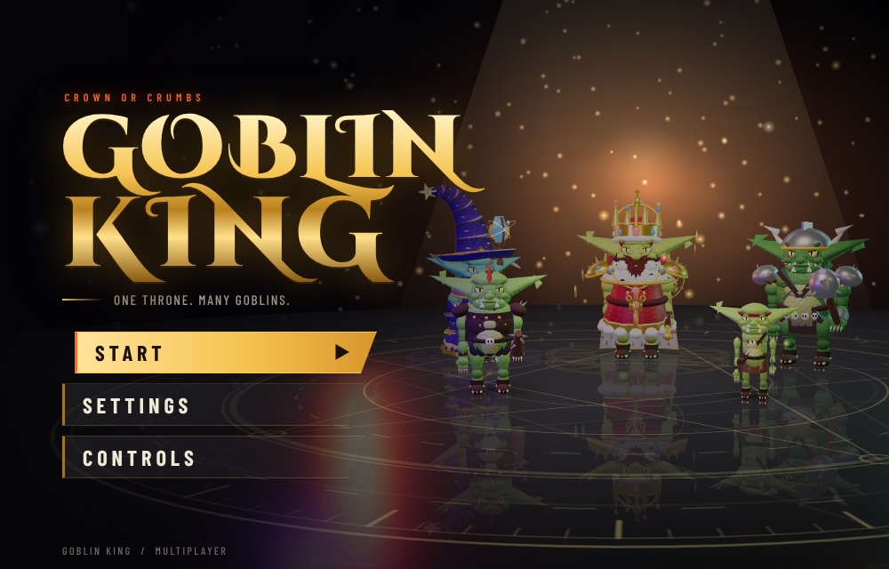
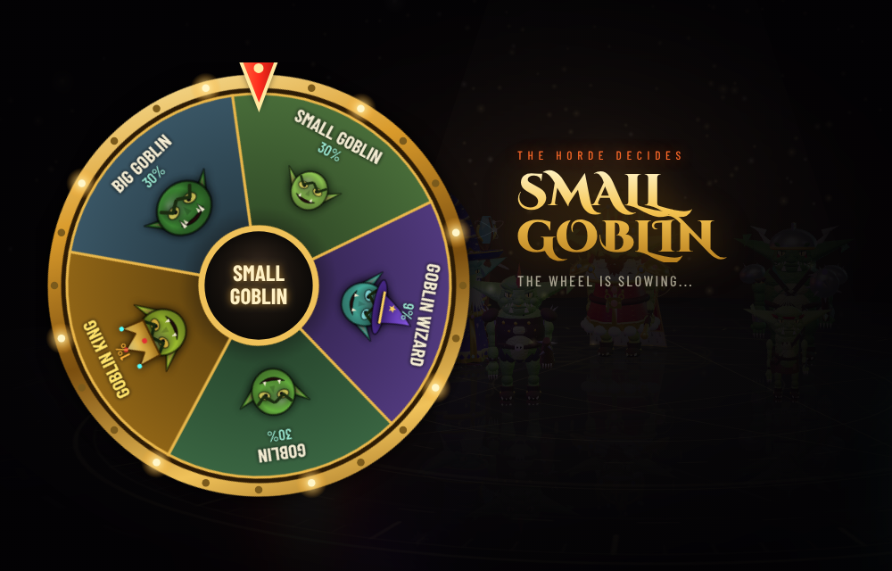
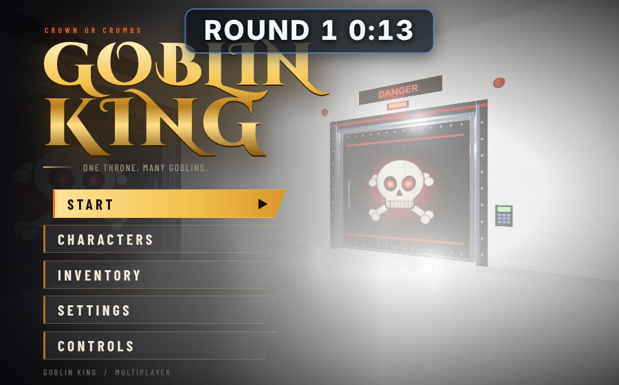
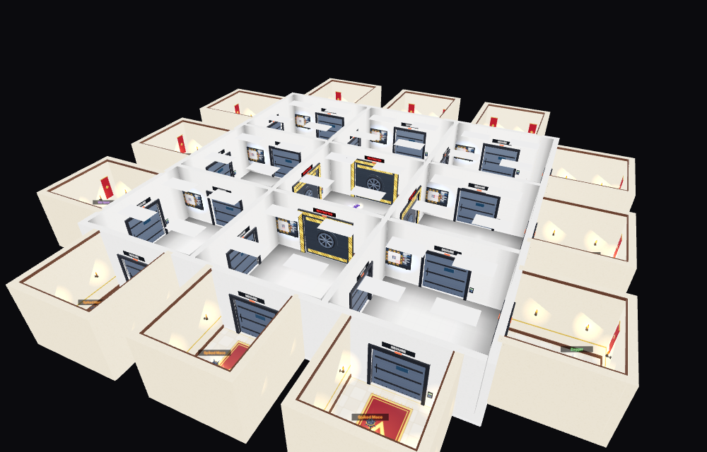

# Goblin King: design notes and status

Browser game (three.js client, Node + ws server). Run: `npm install && npm start`, open http://localhost:3000.
Screenshots live in `docs/screens/`. Agent reports live in `docs/reports/`.

   

## Rules decided so far
- **Goblins** (rolled when you queue, shown on the wheel): Small 30%, Medium 30%, Big 30%, Wizard 9%, King 1%.
- **Stats**: attack comes from the equipped weapon, health from the equipped armour, knowledge is innate.
  Start: Small 60 knowledge / Dagger 10 / Ragged Tunic 40 HP; Medium 40 / Nailed Club 15 / Studded Vest 50;
  Big 30 / Spiked Mace 20 / Warlord Harness 80; Wizard 80 / Gnarled Staff 0 / Starry Robe 60; King 40 / Royal Scepter 20 / Royal Mantle 100.
- **Map**: 3x3 grid of white rooms (12 m), the middle room is **the vault** (to be made bigger than the others). Players spawn in one of the 8 outer rooms, never the vault.
- **Rounds**: first round 30 s, later rounds 45 s. Every room has a control panel where you click a door; when the timer hits 0 that door opens (stays open for the next round).
  A vault door only opens if at least 2 different rooms picked a vault door that round; with 1 pick nothing opens and the turn is wasted.
- **Doors**: doors to the vault are super secure vault doors; doors between player rooms have a skull; doors to chest rooms have yellow bars and a money bag; mystery room doors have a question mark; merchant room doors have the merchant logo.
- **Rooms behind the outer doors (12)**: randomly generated per match as chest, mystery or merchant. Edge rooms (one outer room) can never be merchant; corner rooms (two outer rooms) can be anything.
  - Chest room: chest with a random weapon.
  - Mystery room: random weapon, random armour, random enemy goblin (troll 2, archer 8, speedy 20, dumb 30, regular 50; these add up to 110 so they are used as relative weights), two random stations, a chest of gold, or a goblin plushie.
  - Merchant room: merchant goblin behind glass (click to trade: 5 random items with gold prices), knowledge tree, crafting bench, recycler.
- **Stations**: the recycler and crafting bench can be used by everyone. Recycler turns weapons into parts (wood, metal, leather, cloth, gold, bone, gems, string, crystal).
  Bench crafts tier 0 base items for everyone; higher tiers unlock through the knowledge tree. Knowledge tree has 5 tiers needing 20, 40, 60, 80, 100 knowledge.
- **Items**: 20 base weapons and 20 base armours, each with its own drop chance (each list adds up to 100%); rarer means stronger. Tiers: 0 common, 1 uncommon, 2 rare, 3 mythic, 4 legendary, 5 transcendent.
- **Inventory**: 9 backpack slots + weapon slot + armour slot + 3 quick slots (hotbar).
- **Death**: everything is lost. The dead goblin drops its weapon, armour, inventory and its goblin brain (eat it for 5% of that goblin's knowledge). The player sees a death screen with run stats and can requeue or go to the main menu.
- **Win**: keep the items from your inventory (they go to the start-screen Inventory tab) and the character itself (saved in the Characters tab with its victory count).
- **Win condition (DEFAULT, AWAITING THE OWNER'S DECISION)**: last goblin standing. The match must have had at least 2 players who entered the rooms; when exactly one living player remains and at least one player died, that player wins. If everyone leaves without a death there is no win. This is a placeholder rule and can be changed: it lives in `checkWin()` in server.js (offline demo: `simKill()` in game.js).
- **Match time limit (DEFAULT, AWAITING THE OWNER'S DECISION)**: after round 8 a "Sudden death" banner shows, every door opens (and stays open) and regeneration stops. If the match is still undecided when round 10 ends, the living goblin with the most kills wins, then the most HP; everyone else is out. The matchEnd card says the time limit decided it. Server constants SUDDEN_ROUND = 8, MAX_ROUND = 10 (server.js, SUDDEN block; debug overrides GK_SUDDEN_ROUND, GK_MAX_ROUND, GK_NEXT_ROUND_MS).
- **Combat**: left click swings the equipped weapon (unarmed punch = 1 damage). Damage = attack stat of the weapon (at least 1, so a staff with attack 0 still does 1). Server-validated: per-weapon cooldown (dagger 0.45 s, sword/club/staff/scepter 0.6 s, mace/spear 0.65 s, axe/flail 0.75 s, halberd 0.85 s, hammer 0.9 s, bow 0.7 s, crossbow 1.0 s, unarmed 0.5 s), target within 2.2 m (bows and crossbows 12 m), inside a 70 degree cone either side of the attacker's facing, and in the same room. One target per swing, the nearest valid one. Players who have not entered the rooms yet cannot hit or be hit.
- **Health**: health is the armour's HP. It drops when hit; at 0 the goblin dies (die(): everything drops plus the brain) and the killer's kill count goes up. Regeneration: 1 HP every 4 s when not hit for 6 s. Offline demo: bots have health, walk to the player when within 6 m in the same room, attack with the same rules and drop loot when killed; after the first kill the bot roster is frozen so the player can win by killing them all.
- **Matchmaking**: press Start and the wheel screen is the queue (Finding goblins N/8, time, Cancel). Goblins are queued by similar victory counts; a match forms at 8 players, or after 15 s with at least 1 human, and is closed once formed. Empty slots are filled with server bots (see Bots). Each player spawns in their own outer room. Everyone loads in together, then a 3-2-1-GO countdown runs; movement, attacks and interaction are locked until GO and round 1 starts at GO. Requeue uses the same queue. See docs/reports/matchmaking.md.
- **Bots**: a match always has 8 goblins; the server fills empty slots with bots (normal goblin types and START gear, goblin names, an outer room each). They move only through the validated movement path, path room to room through open doors, vote on doors (explore early, the vault after round 3), claim chest and mystery rooms, buy from the merchant, equip better loot, eat brains, fight within 6 m and flee below 25% HP. No bot attacks in round 1 or the first 20 s after GO. Bots count for "goblins left" and the last-standing win (a human must still be the last one). Mystery-room enemies (troll, archer, speedy, dumb, regular) are hostile NPCs in their room, spawned at GO, with per-type stats; they drop loot, count as a kill and never count for goblins left or the win. See docs/reports/bots.md.

- **Loot additions** (from DESIGN-core-loop sections 2 and 3; no owner rule changed, see docs/reports/loot.md):
  - **Vault relic**: THE VAULT holds one guaranteed tier 3+ item (mythic or better, normal drop weights) on a pedestal beside the medallion. E takes it (server `claim`), first goblin only, only inside the vault. Everyone sees "<name> seized the Vault relic!" in the kill feed. Bots value the vault highly once a vault door is open.
  - **Merchant prices** rise 10% per round after round 2, rounded to 5 gold (server authoritative; the shop shows the current price).
  - **Goblin plushie** (plushie mystery room) is a one-use item. In a quick slot, its key throws it 7 m ahead (server picks the landing). It squeaks, and bots and mystery enemies within 8 m go to it for 3 s. Still a joke item otherwise.
  - **Bots at stations**: in a merchant or stations mystery room a bot recycles junk weapons and crafts one affordable tier 0 recipe.

## Open questions for the owner
- Is "last goblin standing" (see Win condition above) the real win rule? It is only a default for now.
- Is the match time limit (sudden death after round 8, decision after round 10 by kills, then HP) what the owner wants? It is only a default.
- Starting gold is a placeholder of 100.
- How should stash items be brought into a run?
- Recipes for crafting tiers 1 to 5.

## Files
`game.js` client, `menu.js` title screen, `index.html`, `server.js`, `items.js` shared item data (also used by the server), `save.js` saved characters and stash, `icons.js` item icons.
